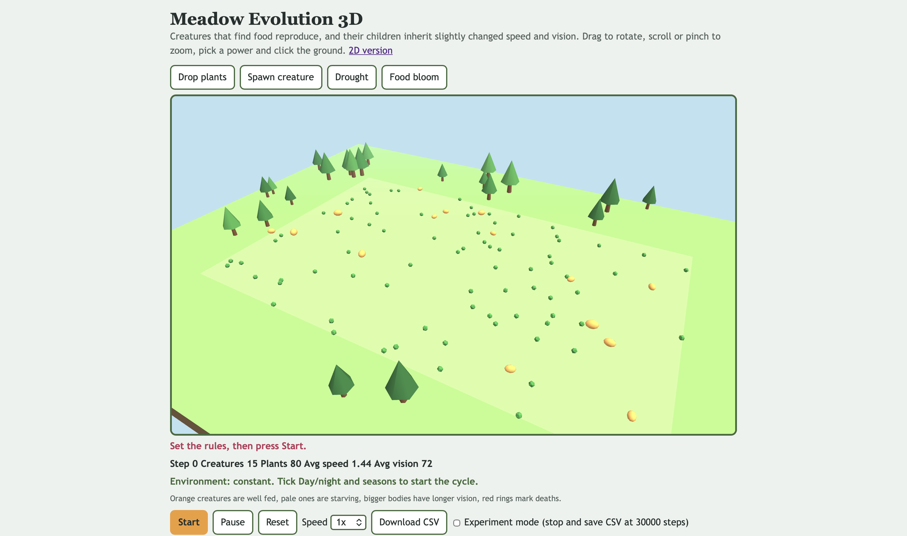

# Meadow Evolution

An evolving ecosystem you can watch and play with in 3D. Creatures wander a meadow, find plants, eat, reproduce and die. Every creature inherits two traits, speed and vision, with small random mutations, so natural selection happens on screen.

**Live demo:** https://fathimarashap.github.io/ecosystem/
**2D version:** https://fathimarashap.github.io/ecosystem/sim.html

Built for the TinkerHub Useless Projects scholarship (November project: a domain I had never worked in, agent-based modelling and evolutionary systems).

## How to play
- **Drag** to rotate the camera, **scroll or pinch** to zoom.
- Pick **Drop plants** or **Spawn creature**, then click the ground.
- **Drought** wipes out most plants and stops regrowth for a while. **Food bloom** adds a burst of new plants.
- Move the sliders (plant growth, living cost, mutation size) while it runs and watch the graphs react.
- Tick **Day/night and seasons** to cycle the lighting and seasons. Seasons change how fast plants grow.
- **Experiment mode** runs for 30,000 steps, then saves a CSV. It turns the day/night cycle off so results stay comparable.

## How it works
- A creature moves toward the nearest plant within its vision. Eating gives energy.
- Living costs energy every step. Faster and longer-sighted creatures pay more, so both traits have a trade-off.
- Above 100 energy a creature reproduces. Its child inherits speed and vision with small mutations. At 0 energy it dies.
- Colour shows energy (orange is well fed, pale is starving), body size shows vision, and a red ring marks a death.

## What I found (preliminary)
I ran 15 simulations with plant growth from 0.10 to 0.50 (one run per value, run in shuffled order, other settings fixed).

- More food supports more creatures, almost in a straight line: about 8 creatures at growth 0.13 and about 33 at 0.50. At growth 0.10 the population died out.
- When food was scarce, creatures tended to evolve longer vision. Runs at growth 0.33 or below averaged about 112 vision, and runs at 0.36 or above averaged about 81. Neighbouring runs vary a lot, so this is a tendency, not an exact curve.
- Speed sat near its cap of 4 in almost every run, so these runs cannot say anything about how speed responds to food.

These are patterns from single runs, not confirmed conclusions.

## Run it locally
1. Download or clone this repo.
2. Open the folder in VS Code and use the Live Server extension on `index.html`, or open the file directly in a browser.
3. Keep `three.min.js` and `chart.umd.js` in the same folder as `index.html`.

## Files
- `index.html`: the 3D version with all features
- `sim.html`: the simpler 2D version
- `three.min.js`, `chart.umd.js`: libraries (Three.js and Chart.js), included so it works offline
- `analyze.html`: reads exported CSVs and plots results
- `data/`: the CSVs from the 15 growth runs
- `LOG.md`: build log, including the mistakes I found and fixed

## Limitations
- One run per setting. Repeating each setting would make the findings reliable.
- Speed is capped at 4 in the code, so speed evolution was not properly tested.
- Stats show averages only, and there is no predator species.

## Future work
- Predators that hunt the creatures, with both sides evolving.
- Weather with real effects (rain, drought, storms), plus birds, butterflies and fireflies.
- Repeated runs with the speed cap raised, and experiments on living cost and mutation size.

## Built with
JavaScript, HTML canvas, Three.js and Chart.js.